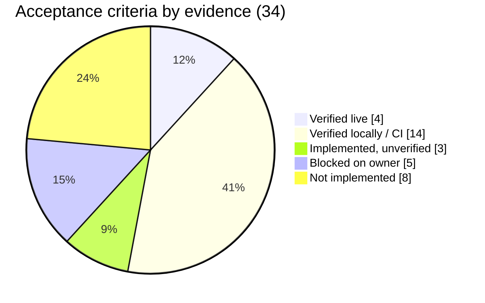

# AEP-X progression dashboard

_Updated 2026-11-15 22:20 UTC. Live release: `5c8c8ae` (ide.softwareequality.com). Open draft PRs: #389, #412, #414; good-hour #24._

**Formula (unweighted, as no weights were approved):**
verified % = 100 × criteria verified on the deployed system ÷ applicable criteria.
"Verified locally/CI" is shown separately and is **not** counted as production-verified.

## Summary — 34 acceptance criteria

| Indicator | Count | % |
|---|---|---|
| **Verified on the live system** | 4 | **11.8 %** |
| Verified locally or in CI (real tests, not yet on the live system) | 14 | 41.2 % |
| Implemented, not yet verified | 3 | 8.8 % |
| Blocked on owner action | 5 | 14.7 % |
| Not implemented | 8 | 23.5 % |

## By workstream

| Workstream | Criteria | Live | Local/CI | Impl. only | Blocked | Not impl. |
|---|---|---|---|---|---|---|
| Frontend IDE | 9 | 3 | 4 | 0 | 0 | 2 |
| Execution / worker isolation | 3 | 0 | 1 | 0 | 0 | 2 |
| Authentication | 8 | 1 | 3 | 0 | 4 | 0 |
| Agents / LLMs | 3 | 0 | 0 | 2 | 0 | 1 |
| MCP security | 1 | 0 | 1 | 0 | 0 | 0 |
| RAG | 1 | 0 | 1 | 0 | 0 | 0 |
| PostgreSQL / RLS / HITL | 1 | 0 | 1 | 0 | 0 | 0 |
| CI/CD and acceptance | 2 | 0 | 1 | 1 | 0 | 0 |
| Build and deploy | 2 | 0 | 0 | 0 | 0 | 2 |
| Marketplace | 1 | 0 | 0 | 0 | 0 | 1 |
| Distribution | 2 | 0 | 1 | 0 | 1 | 0 |
| Specialist IDEs | 1 | 0 | 1 | 0 | 0 | 0 |
| **Total** | **34** | **4** | **14** | **3** | **5** | **8** |

```mermaid
xychart-beta
  title "Criteria per workstream: total vs verified (live + local/CI)"
  x-axis [IDE, Exec, Auth, Agents, MCP, RAG, RLS, CI, Build, Mkt, Dist, Media]
  y-axis "criteria" 0 --> 10
  bar [9, 3, 8, 3, 1, 1, 1, 2, 2, 1, 2, 1]
  bar [7, 1, 4, 0, 1, 1, 1, 1, 0, 0, 1, 1]
```

## Criteria and evidence

| # | Workstream | Criterion | Status | Evidence |
|---|---|---|---|---|
| 1 | IDE | Create project; persists after logout/login | Local/CI | local e2e 14/14 (2026-11-15) |
| 2 | IDE | Edit code; saved changes survive refresh | Local/CI | local e2e save/reload/reopen |
| 3 | IDE | Rename/move/delete files and folders, new folder | Local/CI | #414: API 7/7, e2e 12/12 |
| 4 | IDE | Project search | Local/CI | #414 e2e: opens file at matching line |
| 5 | IDE | Error diagnostics beyond syntax highlighting | Not implemented | — |
| 6 | IDE | Version-control (Git) integration | Not implemented | file history exists, no Git |
| 7 | IDE | Honest signed-out states, no fake success | **Live** | live checks on 5c8c8ae |
| 8 | IDE | Assistant + help on every screen | **Live** | live: help answers |
| 9 | IDE | Import files/folder/.zip | **Live** (deployed); signed-in import verified locally | local e2e; live deploy 5c8c8ae |
| 10 | Exec | Run Python/JS in an isolated sandbox | Local/CI | #412: 12/12 real containers under gVisor in CI; off in production |
| 11 | Exec | Run cancellation | Not implemented | — |
| 12 | Exec | Sandboxed terminal | Not implemented | — |
| 13 | Auth | E-mail registration and sign-in | **Live** (pages); full sign-in verified locally | live registration form; local e2e sign-in |
| 14 | Auth | Password policy | Local/CI | Keycloak 26 admin API + registration rejects weak password |
| 15 | Auth | Google OAuth | Blocked | owner: Google OAuth client |
| 16 | Auth | GitHub OAuth | Blocked | owner: GitHub OAuth app |
| 17 | Auth | Password recovery | Blocked | owner: Resend domain + `AEPX_SMTP_FROM` |
| 18 | Auth | E-mail verification | Blocked | as 17 |
| 19 | Auth | Sessions, refresh, logout | Local/CI | local e2e reload keeps session; silent renew configured |
| 20 | Auth | RBAC + tenant isolation | Local/CI | pytest on PostgreSQL (ACL matrix, RLS, cross-tenant) |
| 21 | Agents | Invoke LLM with usage accounting | Implemented | metered worker deployed; not exercised live |
| 22 | Agents | Traceable agent runs | Implemented | audit/history code; not exercised live |
| 23 | Agents | Tool use + streaming responses | Not implemented | — |
| 24 | MCP | Governed MCP execution (allowlist, approvals, egress) | Local/CI | existing CI security suites; execution off in production |
| 25 | RAG | Tenant-scoped retrieval | Local/CI | existing pgvector tests in CI |
| 26 | RLS/HITL | Atomic approvals, replay prevention, fenced leases | Local/CI | existing HITL acceptance workflows green |
| 27 | CI | GitHub Actions jobs schedule and run (#370) | Local/CI | runs execute today (e.g. 136/136 on #412) |
| 28 | CI | 50 × 2 acceptance on current master | Implemented | **fails on master** (3 test defects); fixed in #389 (unmerged); passes locally with #389 |
| 29 | Build | Downloadable build artifact from a project | Not implemented | — |
| 30 | Deploy | Deploy a project with health verification | Not implemented | — |
| 31 | Marketplace | Install/enable/disable/uninstall plugins in the IDE | Not implemented | — |
| 32 | Distribution | Desktop + Android installers built and downloadable | Local/CI | release ide-v0.3.0: 16 downloads return 200 |
| 33 | Distribution | Signed desktop installers | Blocked | owner: code-signing certificates |
| 34 | Media | Specialist editors with export (MIDI, WAV, SRT, EDL, HTML, clients) | Local/CI | vitest; deployed, not exercised signed-in live |

## Next (in order)
1. Owner merges #389 → dispatch 50 × 2 on master (criterion 28).
2. Owner approves #412/#414 merge + deploy; owner signs in once on production so 1–4, 9, 13, 19, 21–22 and 34 can be verified live.
3. Run cancellation and diagnostics (5, 11); then build artifacts via GitHub Actions (29).
