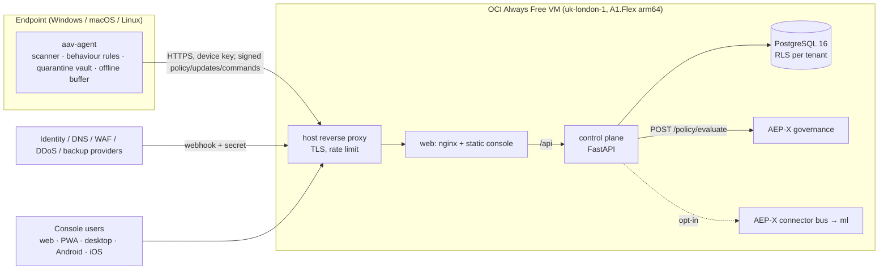

# Architecture, data flow and threat model

## Context

| Component | Code | Responsibility (register IDs) |
|---|---|---|
| Endpoint agent | `agent/aav_agent` | ARC-01, AV-01/02, EDR-01/02, OPS-02 |
| Detection engine | `detection/aav_detection` (shared by agent and file scanning) | ARC-03 |
| Control plane | `control-plane/app` | ARC-02, OPS-01, AI-02, RSP-*, BE-* |
| Investigation | `control-plane/app/routers/investigation.py` | ARC-04, AI-01, DDOS-05 |
| Policy engine + catalogue | `catalogue.py`, `routers/actions.py` | AI-02, RSP-01..07 |
| AEP-X adapter | `governance.py` (reuses `services/governance`) | AX-01, AX-06, AX-07 |
| Console | `web/` (Next.js static export) | UI-*, L10N-*, VOC-* |
| Clients | `clients/android`, `clients/ios`, `clients/desktop` | PLT-*, DST-* |
| Deployment | `deploy/` | OCI-* |

## Governed action path (AX-06)

1. **Authenticate:** session token (users) or device key (agents); tenant from `X-Tenant-Id`, accepted only with a membership.
2. **Validate:** the action must be in the typed catalogue, with typed parameters. Every target must exist in the tenant; RLS hides other tenants, so a cross-tenant ID returns 404.
3. **Decide:** the product policy engine applies the PRD §5 defaults (auto / approval / admin with reason). A multi-endpoint action always needs approval. A quarantine counts as a known-malware match only against the server's signed bundle, never the caller's claim.
4. **Govern:** AEP-X `POST /policy/evaluate` with the action's S-class. Unreachable or not configured means deny.
5. **Approve:** a single-use approval bound to the action type, a digest of targets and params, the tenant and an expiry.
6. **Dispatch:** governance is re-checked at execution time. Each target gets an Ed25519-signed command with an idempotency key `request:device`.
7. **Execute:** the agent verifies the signature against the pinned key, checks device, tenant and expiry, and records the idempotency key locally.
8. **Acknowledge:** the result is recorded per device, and the request becomes completed or failed. Every step writes a hash-chained audit entry.

## Data model

All tables are in `migrations/001_init.sql`. Every tenant table has `FORCE ROW LEVEL SECURITY`, with policy `tenant_id = current_setting('aav.tenant_id')`. The app connects as `aav_app` (no superuser, no BYPASSRLS). Pre-tenant lookups (login, device key, enrolment token, webhook) go through narrow `SECURITY DEFINER` functions with a pinned `search_path`. The audit log is append-only (trigger) and hash-chained, with tamper detection tested.

## Threat model (STRIDE)

| Threat | Example | Control | Test |
|---|---|---|---|
| Spoofing | forged command or policy to an endpoint | Ed25519 signatures, key pinned at enrolment | `test_invalid_policy_signature_keeps_last_verified`, tampered update test |
| Spoofing | stolen enrolment token | single/limited use, expiry, hashed at rest | enrolment tests |
| Tampering | editing audit history | append-only trigger + hash chain verification | `test_audit_chain_verifies_and_is_append_only` |
| Tampering | agent config change | fingerprint watch → tamper alert | `test_removable_media_and_tamper_events` |
| Repudiation | "I never approved that" | approver, targets, expiry in audit; approval rows immutable after use | approvals tests |
| Information disclosure | cross-tenant read | RLS + membership check | `test_rls_enforced_at_database_level` |
| Information disclosure | secrets in model context / logs | allowlisted evidence fields; redaction in self-correction; secret refs only | `test_observe_redacts_secrets...`, integration config check |
| Denial of service | telemetry floods | batch limit 1,000, idempotent replay, bounded agent buffer; host rate limiting; upstream DDoS provider | buffer tests |
| Elevation of privilege | prompt injection in evidence | evidence is data; AI principal can only propose; output validated | `test_prompt_injection_in_evidence_cannot_alter_policy_or_permissions` |
| Elevation of privilege | SSRF through integrations | TLS-only schemes, allowlist, public-address check | `test_egress_policy_blocks_ssrf` |
| Elevation of privilege | archive path traversal / symlinks | path validation, link rejection, per-member scanning | `test_bulk_import_export_and_archive_attacks` |
| Governance bypass | AEP-X down → actions still run | deny when unreachable at propose and at dispatch | `test_governance_outage_fails_closed` |

Residual risks: the user-mode agent can be stopped by a local administrator (B-01). The signing key on the VM is a single point of trust; an HSM or OCI Vault would remove it, but OCI Vault software keys are free while HSM is not, so it needs a decision.

## Decision records

1. **ADR-1 Monorepo product directory.** Reuses `services/governance` directly and pins AEP-X by the branch base (`57c40ec`). Chosen by the owner on 18 Nov 2026.
2. **ADR-2 Python user-mode agent first.** The same code runs on all three OSes and CI builds six binaries. Kernel-level blocking is a separate, signed component (B-01).
3. **ADR-3 Static-export console.** No Node server on the VM (saves Always Free RAM). The same build serves web, PWA, desktop and mobile shells.
4. **ADR-4 Ed25519 for all control-plane signatures.** Small keys, fast verification, available in `cryptography` on every target.
5. **ADR-5 Two independent checks for every action.** Product policy plus AEP-X governance, so a bug in either alone cannot authorise an action.
6. **ADR-6 Licences only from verified store receipts.** There is no admin "mark as paid", which keeps billing consistent with Play policy.

## Capacity plan (single A1.Flex VM)

The compose limits total 2.0 OCPU and 1.9 GB RAM, within the 2 OCPU / 12 GB the preflight requires to be free. Per-tenant telemetry storage is bounded by retention settings. The 1,000-endpoint baseline (NFR-02) has not been load-tested (B-09).
